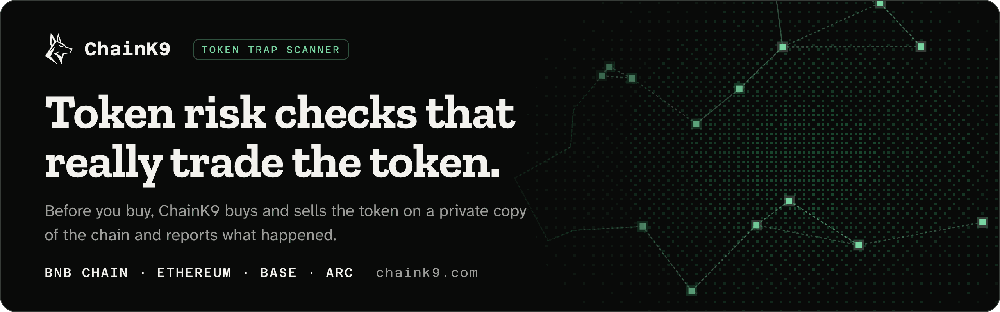
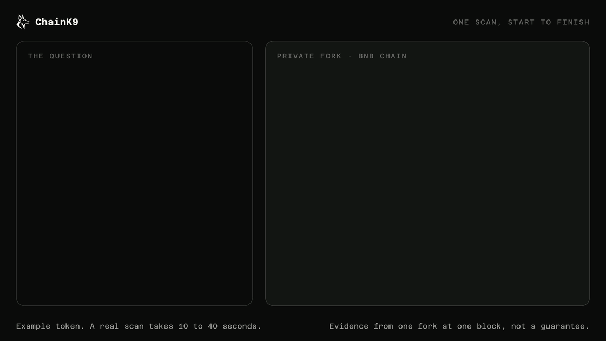
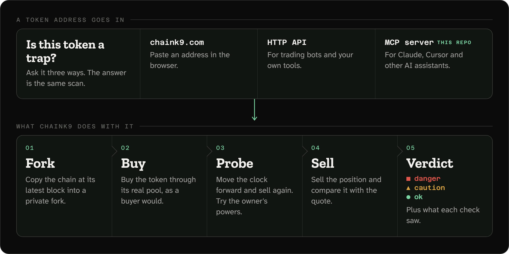

<p align="center">
  <a href="https://chaink9.com"></a>
</p>

<p align="center">
  <a href="https://www.npmjs.com/package/chaink9-mcp"></a>
  <a href="https://chaink9.com/accuracy"></a>
  <a href="LICENSE"></a>
</p>

# ChainK9

ChainK9 checks whether a token is a trap before you buy it. It looks for honeypots that can be
bought but not sold, hidden or changing taxes, owners who can pause, blacklist, mint or take
tokens, and liquidity that one wallet can pull. It covers BNB Smart Chain, Ethereum, Base and Arc.

Most token scanners read flags from someone else's API. ChainK9 does what a buyer would: it forks
the chain, buys the token through its real market (PancakeSwap or Uniswap V2, V3 or V4, hooks
included), sells it again, and runs 70+ checks on what happened. A honeypot gets caught when its
sell fails on the fork, however clean its code looks.

<p align="center">
  
</p>

<p align="center"><sub>An example token, sped up. A real scan takes 10 to 40 seconds.</sub></p>

There are three ways to use it:

- [chaink9.com](https://chaink9.com): paste a token address in the browser.
- The [HTTP API](https://chaink9.com/developers), for trading bots and your own tools.
- This repository, an MCP server that gives the same checks to Claude, Cursor and other AI
  assistants. [Install it](#install) in one line.

## How a scan works

<p align="center">
  
</p>

1. Fork. ChainK9 copies the chain at its latest block into a private fork.
2. Buy. It buys the token through its real pool, as a buyer would.
3. Probe. It moves the clock forward and sells again, tries the owner's powers as the owner, and
   rewinds each probe so the position is still there for the next one.
4. Sell. It sells the position and compares what came back with the pool's quote.
5. Verdict. It answers danger, caution or ok, with what every check saw.

A check fails only on something that happened on the fork or on state that was read. A function
that merely exists in the bytecode is a warning at most, and a check that could not run is
reported as skipped.

## What it checks

| Question | What ChainK9 does on the fork |
|---|---|
| Can you sell? | Buys, sells right away, then moves the clock forward and sells again. |
| What does a trade cost? | Compares what a buy and a sell return with the pool's quote, and looks for taxes that change over time or after several sells. |
| What can the owner do? | Tries pause, blacklist, mint and confiscation as the owner. |
| Are there limits? | Tests transfer limits, sell limits and cooldowns. |
| Can the liquidity leave? | Reads the pool and, in the deepest scan, whether one wallet holds its liquidity tokens. |
| Can the code change? | Checks for a proxy and who holds the upgrade authority. |

A trimmed real report, for CAKE on BNB Smart Chain in October 2026:

```json
{
  "token": "0x0e09fabb73bd3ade0a17ecc321fd13a19e81ce82",
  "chain": "bsc",
  "verdict": "caution",
  "block": 128151663,
  "elapsed_ms": 22555,
  "pool_version": "v2",
  "tier": "full",
  "results": [
    { "module": "sellability", "severity": "critical", "status": "pass",
      "detail": "sell succeeded — the position is exitable" },
    { "module": "sell_tax", "severity": "critical", "status": "pass",
      "detail": "sell output shortfall versus pre-trade router quote: 0.00%" },
    { "module": "hidden_mint", "severity": "high", "status": "warn",
      "detail": "impersonated owner mint(address,uint256) executed; the owner is a contract, so issuance follows its code, which was not audited" }
  ],
  "report_url": "https://chaink9.com/token/bsc/0x0e09fabb73bd3ade0a17ecc321fd13a19e81ce82"
}
```

## How often it is right

ChainK9 scans new launches in the background. For each one it writes down its own verdict and, at
the same moment, the verdicts of honeypot.is and GoPlus. A day later it checks what really
happened on the chain: whether outside wallets sold, and whether a fresh wallet could still sell.

The catch rate, false alarms and precision for all three scanners are public at
[chaink9.com/accuracy](https://chaink9.com/accuracy), updated every hour. Weekly reports go out on
X at [@ChainK9x](https://x.com/ChainK9x), such as
[this one](https://x.com/ChainK9x/status/2121548151895330961).

## Install

Claude Code:

```bash
claude mcp add chaink9 -e CHAINK9_PRIVATE_KEY=0x... -- npx -y chaink9-mcp
```

Cursor, Claude Desktop or any client with a JSON config:

```json
{
  "mcpServers": {
    "chaink9": {
      "command": "npx",
      "args": ["-y", "chaink9-mcp"],
      "env": { "CHAINK9_PRIVATE_KEY": "0x..." }
    }
  }
}
```

Claude Desktop can also install the `.mcpb` bundle from the
[releases](https://github.com/ChainK9/chaink9-mcp/releases) with a click. Then ask:

```text
Check 0x0E09FaBB73Bd3Ade0a17ECC321fD13a19e81cE82 on BSC with ChainK9 before I buy it.
```

Scans are paid per call, from $0.002 to $0.05, out of a wallet you set up for this. See
[Paying for scans](#paying-for-scans). The stored verdict for a token is free, with nothing to
install:

```bash
curl "https://api.chaink9.com/verdict?token=0x0E09FaBB73Bd3Ade0a17ECC321fD13a19e81cE82&chain=bsc"
```

## Tools

The tool list is read live from [api.chaink9.com](https://api.chaink9.com/openapi.json), so new
tools appear without updating this package. Every tool takes `chain`: `bsc` (the default), `eth`,
`base` or `arc`.

Check a token:

| Tool | Price | What it does |
|---|---|---|
| `scan` | $0.02 | Full check: honeypot, buy and sell taxes and how they change, owner pause, blacklist, mint and confiscation powers, limits, liquidity, upgrade authority. |
| `scan-lite` | $0.005 | Faster check for bots (2 to 5 s): one real buy and sell plus the contract reads. Skips the extra trades and the time-travel probes. |
| `scan-ultra` | $0.05 | Everything in `scan`, plus who holds the token: the top holder's and top 10's share, and whether one wallet can pull the liquidity. |
| `report` | $0.002 | The latest stored scan of a token, without running a new one. |
| `risk-changes` | $0.002 | What changed between a token's last two scans. |
| `liquidity-report` | $0.003 | The token's pool: reserves and LP tokens (V2), or liquidity and price (V3 and V4). |
| `deployer-report` | $0.005 | A token's verified creator and their other known tokens. |

Follow new launches:

| Tool | Price | What it does |
|---|---|---|
| `feed` | $0.002 | Tokens that just got a market, with a verdict where scanned. |
| `launch-feed` | $0.003 | New markets that are actually funded, optionally filtered by verdict. |

Test a wallet's own trade:

| Tool | Price | What it does |
|---|---|---|
| `simulate-trade` | $0.02 | A buy or sell for a given wallet on a fork, with its real balances. |
| `exit-check` | $0.04 | Up to four sell sizes from a wallet's real balance. |
| `transaction-preview` | $0.02 | Any transaction run on a fork, with the balance changes it causes. |
| `portfolio-screen` | $0.005 | A wallet's balances of the tokens you name, riskiest first. |

Follow the money:

| Tool | Price | What it does |
|---|---|---|
| `trace` | $0.01 | Follows the money out of one transaction, wallet to wallet and through swaps, up to five hops, until it rests, is burned, or reaches a mixer or a busy wallet such as an exchange. |

## Check before you buy

[`examples/check-before-buy.mjs`](examples/check-before-buy.mjs) is a small gate to put in front of a
trading bot's buy. It reads the free stored verdict first. If that is "danger", it says don't buy
and pays nothing. If the verdict is missing, could not decide, or is older than an hour, it pays for
one `scan-lite` ($0.005) and decides on that. It buys only on "ok".

```bash
git clone https://github.com/ChainK9/chaink9-mcp && cd chaink9-mcp && npm install
CHAINK9_PRIVATE_KEY=0x... node examples/check-before-buy.mjs 0x0E09FaBB73Bd3Ade0a17ECC321fD13a19e81cE82 bsc
```

It prints the decision with the checks that failed or warned and a link to the token's report, and
exits 0 to buy, 1 not to, 2 when it could not check. Import `checkBeforeBuy` to use it from your
own code. Instead of a wallet, `CHAINK9_API_KEY` pays from the credits of a
[chaink9.com](https://chaink9.com/signin) account. `npm test` runs it against a fake API, with no
network and no money.

## Paying for scans

No account is needed. Each successful call is paid from a wallet you choose, in
USDC on Base or USDT on BNB Smart Chain, using the [x402](https://x402.org) payment protocol. A
call that fails costs nothing: bad input, an address that is not a token, a token with no
liquidity, a busy engine.

1. Make a new wallet for this and put a few dollars of USDC on Base in it. It needs no ETH,
   because the payments are signatures and the payment service pays the gas.
2. Give the server that wallet's private key as `CHAINK9_PRIVATE_KEY`.

To pay on BNB Smart Chain instead, fund the wallet with USDT on BSC plus about $0.01 of BNB and
set `CHAINK9_PAY_NETWORK=bsc`. BSC's USDT is paid through Permit2. The first payment also signs a
one-time approval, which is the only thing that uses the BNB.

| Variable | Default | Meaning |
|---|---|---|
| `CHAINK9_PRIVATE_KEY` | (required) | Private key of the dedicated wallet that pays. |
| `CHAINK9_PAY_NETWORK` | `base` | `base` pays in USDC on Base, `bsc` in USDT on BNB Smart Chain. |
| `CHAINK9_MAX_USD_PER_CALL` | `0.05` | Any single payment above this is refused. |
| `CHAINK9_MAX_USD_PER_DAY` | `1` | Stops paying once this much was spent today (UTC). |

The key never leaves your machine, and the wallet only signs payments on the network you chose.
The daily total is kept in `~/.chaink9-mcp/spend.json`.

## Hosted server, no install

`https://api.chaink9.com/mcp` serves the same tools over streamable HTTP, for MCP 2025 and
2026-07-28 clients alike. It adds a free `verdict` tool: the stored verdict for a token and the
names of the checks that flagged it.

Paid tools on the hosted server take the payment inside the MCP call, so they need an x402-aware
client such as [`@x402/mcp`](https://www.npmjs.com/package/@x402/mcp)'s `createx402MCPClient`.
Ordinary MCP clients can connect and use `verdict`. To pay from those, use the package above.

## Use with Cloudflare Code Mode

[Code Mode](https://developers.cloudflare.com/agents/tools/codemode/) gives a model one tool that
runs code, with your MCP servers available inside a sandbox as a typed API. Add the hosted server
and ChainK9's tools become functions such as `verdict`, `scan_lite` and `scan`:

```ts
// In an Agents SDK agent (Code Mode needs a Worker Loader binding named LOADER)
import { DynamicWorkerExecutor } from "@cloudflare/codemode";
import { createCodeTool } from "@cloudflare/codemode/ai";

await this.addMcpServer("chaink9", "https://api.chaink9.com/mcp");
const codemode = createCodeTool({
  tools: this.mcp.getAITools(),
  executor: new DynamicWorkerExecutor({ loader: this.env.LOADER }),
});
```

The model can then check a batch of tokens in one run instead of one tool call each:

```js
async () => {
  const tokens = ["0x0E09FaBB73Bd3Ade0a17ECC321fD13a19e81cE82" /* , ... */];
  const verdicts = await Promise.all(tokens.map((token) => codemode.verdict({ token, chain: "bsc" })));
  return verdicts.filter((v) => v.verdict === "danger").map((v) => ({ token: v.token, failed: v.failed }));
}
```

`verdict` is free and works as shown. The paid tools need the payment added outside the sandbox,
so the code the model writes never sees a wallet. Connect with
[`@x402/mcp`](https://www.npmjs.com/package/@x402/mcp) and give that client to a connector:

```ts
import { McpConnector } from "@cloudflare/codemode";
import { StreamableHTTPClientTransport } from "@modelcontextprotocol/sdk/client/streamableHttp.js";
import { CfWorkerJsonSchemaValidator } from "@modelcontextprotocol/sdk/validation/cfworker-provider.js";
import { createx402MCPClient } from "@x402/mcp";
import { ExactEvmScheme } from "@x402/evm/exact/client";
import { privateKeyToAccount } from "viem/accounts";

const x402 = createx402MCPClient({
  name: "my-agent",
  version: "1.0.0",
  schemes: [{ network: "eip155:8453", client: new ExactEvmScheme(privateKeyToAccount(env.PAYER_KEY)) }],
  autoPayment: true,
  // Workers can't compile schemas with Ajv: validate the way the Agents SDK does.
  mcpClientOptions: { jsonSchemaValidator: new CfWorkerJsonSchemaValidator({ draft: "7" }) },
});
await x402.connect(new StreamableHTTPClientTransport(new URL("https://api.chaink9.com/mcp")));
const { tools } = await x402.listTools();

class ChainK9 extends McpConnector<Env> {
  name() { return "chaink9"; }
  protected createConnection() {
    return { tools, client: { callTool: ({ name, arguments: args }) => x402.callTool(name, args) } };
  }
}
```

Use a dedicated wallet with a few dollars of USDC on Base, and set a limit in
`onPaymentRequested` as with any x402 client.

## What is open and what is not

The scan engine is closed source. This repository is open so you can read what runs on your
machine and signs with your wallet: [`index.js`](index.js), about 140 lines.

Three more ChainK9 tools are open source:

- [bsc-honeypot-benchmark](https://github.com/ChainK9/bsc-honeypot-benchmark): 47 test tokens for
  BNB Smart Chain, 37 of them with a hidden trick, for testing any token scanner. They are the
  set ChainK9's own checks are tested against.
- [bsc-block-time](https://github.com/ChainK9/bsc-block-time): turns BNB Smart Chain block numbers
  into dates across every block-speed change, and finds contracts that still count time in blocks.
- [bsc-lp-lock-checker](https://github.com/ChainK9/bsc-lp-lock-checker): checks whether a BNB
  Smart Chain token's liquidity is really locked, until when, and who controls the lock.

Danger catches are posted to the Telegram channel [t.me/chaink9](https://t.me/chaink9). For
questions and bug reports, [open an issue](https://github.com/ChainK9/chaink9-mcp/issues) or write
to hello@chaink9.com.

## Disclaimer

ChainK9 reports what happened when it traded the token on a private copy of its blockchain at
the block shown. That is evidence, not a guarantee: a token's owner can change its rules after
the scan, and a trap that no check tests can be missed. Nothing here is financial advice. You
trade at your own risk.
